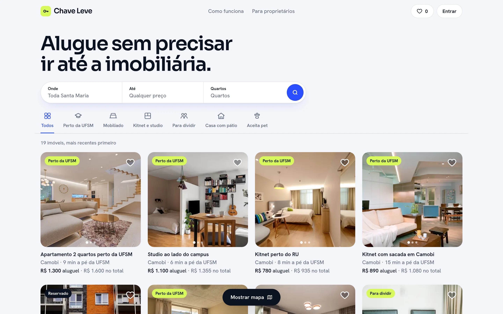
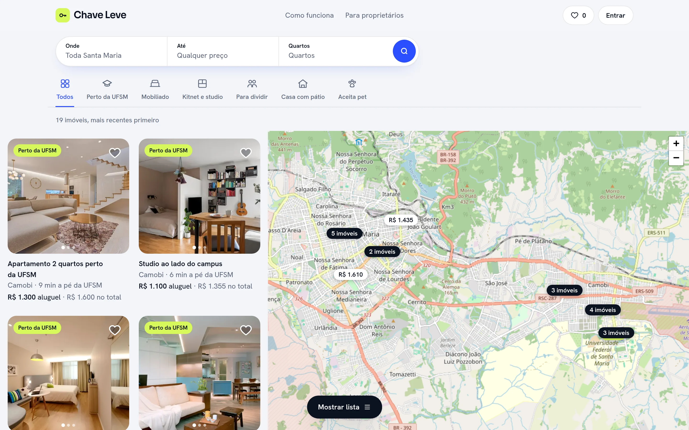
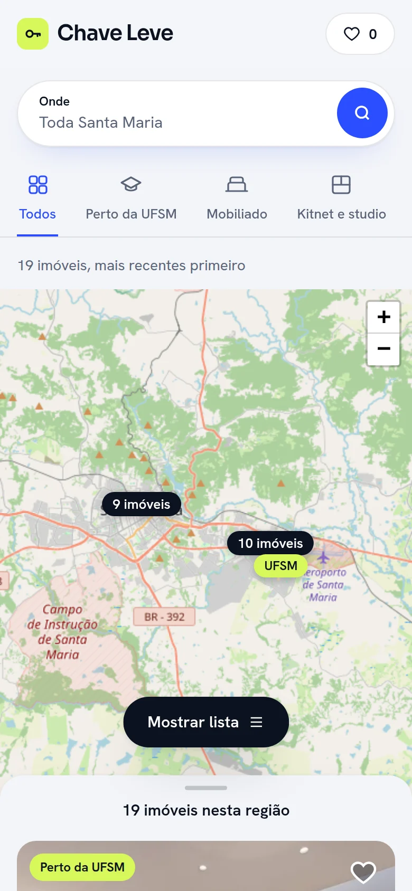
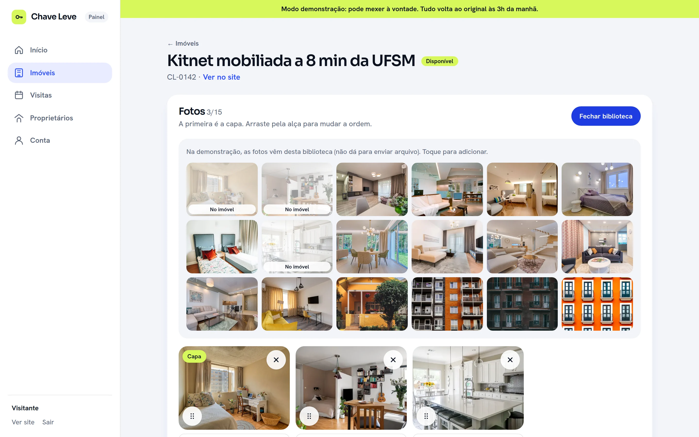
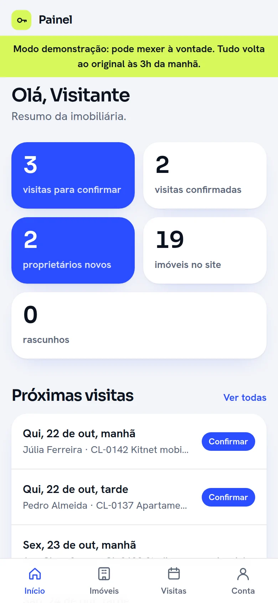

# Chave Leve Imóveis

Site de uma imobiliária **fictícia** de aluguel para estudantes em Santa Maria/RS, perto da UFSM.
É um projeto de demonstração, feito para portfólio (pacote **Com painel**): tem um site público
e um painel completo para a equipe da imobiliária administrar os imóveis.

<p>
  
  &nbsp;
  
</p>

## O site público

- **Busca** com filtros (bairro, preço total, quartos, categorias) e dois modos: **grade e mapa**
- **Mapa** de Santa Maria com o custo total em cada pino; **pinos próximos viram um grupo** ("8 imóveis")
  que aproxima o mapa ao tocar
- **Anúncio** de cada imóvel: fotos, características, custo detalhado, mapa da região (o endereço
  exato nunca vai para o público) e **agendamento de visita**
- **Favoritos** (guardados no próprio navegador) e formulário **"Anuncie seu imóvel"**

<p>
  
  &nbsp;
  
</p>

## O painel da equipe

- **Login** com senha provisória, trocada no primeiro acesso
- **Imóveis**: criar, editar, **fotos arrastáveis** (reduzidas no aparelho antes de subir) e mapa para
  marcar a região
- **Visitas** e **proprietários** interessados, com atalho para o WhatsApp
- **Equipe**: o dono cria os logins dos corretores
- Dois níveis de acesso: o **dono** vê tudo; o **corretor** só os próprios imóveis e visitas
- **Conta de demonstração** ("Ver o painel como visitante"): quem vê o portfólio mexe no painel à
  vontade, e tudo volta ao original toda noite

<p>
  
  &nbsp;
  
</p>

## Qualidade e segurança

- **Supabase** (Postgres + Auth): o que cada pessoa vê e muda é decidido pelas regras do banco (RLS),
  testadas com dezenas de ataques simulados, e confirmadas por `/security-review` sem apontamentos
- O endereço exato dos imóveis nunca é liberado para o público (permissão por coluna)
- Acessibilidade WCAG 2.1 AA: teclado em tudo, foco visível, leitor de tela (axe sem violações),
  funciona com zoom de 200%
- Lighthouse: acessibilidade e boas práticas 100
- Cabeçalhos de segurança; formulários validados no servidor, com proteção contra robôs
- Respeita a opção "reduzir movimento" do sistema

Os dados de exemplo ficam no Supabase; a identidade visual e as regras de interface estão em
`DESIGN.md`, e o processo de criação em `BRIEFING.md` e `ORGANIZACAO.md`.

## Feito com

- [Next.js](https://nextjs.org) 16, React 19 e TypeScript
- [Supabase](https://supabase.com) (Postgres, Auth, Storage, RLS)
- [Tailwind CSS](https://tailwindcss.com) 4
- [Base UI](https://base-ui.com) (gavetas, abas, diálogos) e [dnd-kit](https://dndkit.com) (arrastar fotos)
- [Leaflet](https://leafletjs.com) + [OpenStreetMap](https://www.openstreetmap.org) (mapa)
- Fontes Sora e Hanken Grotesk
- Fotos do [Pexels](https://www.pexels.com)

## Rodar no computador

```bash
npm install
npm run dev
```

Precisa de um `.env.local` com `NEXT_PUBLIC_SUPABASE_URL` e `NEXT_PUBLIC_SUPABASE_PUBLISHABLE_KEY`
(a chave publicável não é segredo; quem protege os dados são as regras do banco). Os detalhes do
banco estão em `supabase/LEIAME.md`.

---

Criado por Lorenzo Guerra Turchetti.
